

<picture><source media="(prefers-color-scheme: dark)" srcset="assets/hero-dark.svg"></picture>

<picture><source media="(prefers-color-scheme: dark)" srcset="assets/social-l-dark.svg"></picture><a href="https://discord.com/users/817806878423646247"><picture><source media="(prefers-color-scheme: dark)" srcset="assets/social-1-dark.svg"></picture></a><a href="https://last.fm/skippingclass"><picture><source media="(prefers-color-scheme: dark)" srcset="assets/social-2-dark.svg"></picture></a><picture><source media="(prefers-color-scheme: dark)" srcset="assets/social-r-dark.svg"></picture>

<a href="https://github.com/skippingclass/TuneCloud"><picture><source media="(prefers-color-scheme: dark)" srcset="assets/project-tunecloud-dark.svg"></picture></a>&nbsp;<a href="https://github.com/skippingclass/dots"><picture><source media="(prefers-color-scheme: dark)" srcset="assets/project-dots-dark.svg"></picture></a>

<a href="https://github.com/skippingclass/TuneCloud-GitOps"><picture><source media="(prefers-color-scheme: dark)" srcset="assets/project-tunecloud-gitops-dark.svg"></picture></a>&nbsp;<a href="https://github.com/skippingclass/plasma-lrc"><picture><source media="(prefers-color-scheme: dark)" srcset="assets/project-plasma-lrc-dark.svg"></picture></a>

<a href="https://github.com/skippingclass/plasma-ai-status"><picture><source media="(prefers-color-scheme: dark)" srcset="assets/project-plasma-ai-status-dark.svg"></picture></a>&nbsp;<a href="https://github.com/skippingclass/SpicetifySongProds"><picture><source media="(prefers-color-scheme: dark)" srcset="assets/project-spicetifysongprods-dark.svg"></picture></a>

<picture><source media="(prefers-color-scheme: dark)" srcset="assets/stack-dark.svg"></picture>

<picture><source media="(prefers-color-scheme: dark)" srcset="assets/stats-dark.svg"></picture>

<picture><source media="(prefers-color-scheme: dark)" srcset="assets/button-l-dark.svg"></picture><a href="https://realgeek.ru"><picture><source media="(prefers-color-scheme: dark)" srcset="assets/button-1-dark.svg"></picture></a><a href="https://github.com/skippingclass?tab=repositories"><picture><source media="(prefers-color-scheme: dark)" srcset="assets/button-2-dark.svg"></picture></a><picture><source media="(prefers-color-scheme: dark)" srcset="assets/button-r-dark.svg"></picture>

<a href="https://metawka.github.io/expressive-profile/?from=skippingclass"><picture><source media="(prefers-color-scheme: dark)" srcset="assets/credit-dark.svg"></picture></a>

